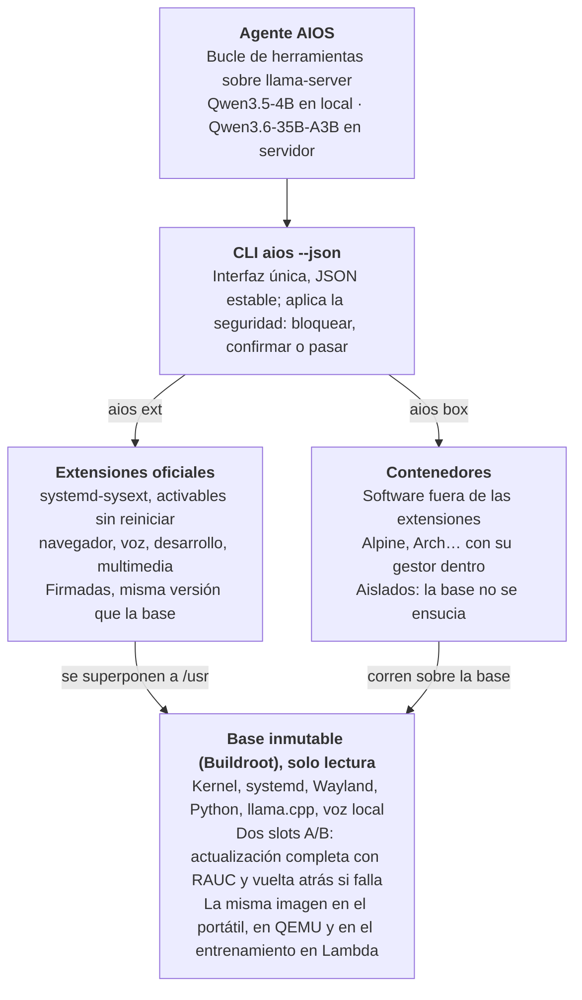
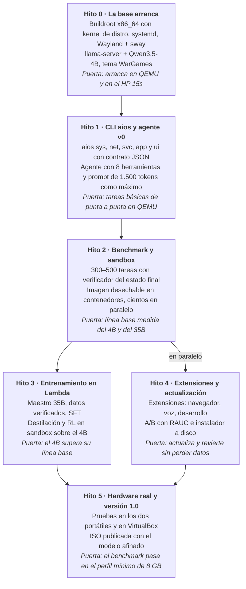

# AIOS — Arquitectura del nuevo sistema

28 oct 2026 · Carlos Carrillo

> Documento vivo. Versión editable con comentarios: https://claude.ai/artifact/CzewYVmVsFb1nMa3wgMEN2

## Resumen

El nuevo AIOS es un sistema operativo construido desde cero con Buildroot y diseñado alrededor de un agente de IA pequeño que corre en la CPU de portátiles antiguos de 8 GB. El agente es un experto en informática (de bajo nivel a arquitectura y SRE), habla los idiomas europeos, ve la pantalla y usa herramientas; si el usuario tiene un servidor, puede apoyarse en un modelo grande.

La diferencia con aios-lfs no es la base, sino el orden de diseño: allí el agente se adaptó a un sistema que crecía a base de parches; aquí el SO, la interfaz del agente y el entrenamiento del modelo se diseñan juntos desde el primer día.

| Pieza | aios-lfs | Nuevo AIOS |
| --- | --- | --- |
| Base | LFS 13 + sven (paquetes de Arch) | Buildroot, imagen inmutable con actualización A/B |
| Software extra | sven sobre la raíz, que se modifica | Extensiones `systemd-sysext` propias + contenedores |
| Interfaz del agente | 29 herramientas, salida de texto libre | ~8 herramientas fijas + paquetes bajo demanda, CLI `aios` con JSON |
| Prompt fijo | ~7.000 tokens con 8K de contexto | ≤ 1.500 tokens |
| Modelo local | Qwen3.5-9B Q4 (6,2 GB) | Qwen3.5-4B afinado para AIOS |
| Modelo servidor | Qwen3.6-35B-A3B sin entrenar | Qwen3.6-35B-A3B afinado (y maestro del 4B) |
| Se conserva | — | Local + servidor, voz y visión, estética WarGames |

## Principios de diseño

Cada decisión técnica se valida contra seis principios; si una funcionalidad los rompe, se rediseña antes de construirla.

1. **El modelo pequeño manda.** Todo se diseña para que un 4B en CPU lo haga bien. Lo que funcione solo con el modelo grande es un extra, no la base.
2. **El SO habla en estructurado.** El agente trabaja con la CLI `aios`, que devuelve JSON corto y errores con código. La shell libre existe, pero es el último recurso.
3. **El conocimiento va en los pesos y en la documentación, no en el prompt.** Prompt fijo de 1.500 tokens como máximo; el resto se consulta con una herramienta.
4. **La seguridad vive en el SO.** Raíz de solo lectura, A/B, confirmaciones y bloqueos aplicados por el sistema, no pedidos al modelo por favor.
5. **Todo es verificable.** Cada funcionalidad nace con sus casos de prueba y un verificador del estado final. Eso es a la vez el benchmark y la fábrica de datos de entrenamiento.
6. **Una sola imagen, en todas partes.** La misma imagen arranca en el portátil, en QEMU y en los contenedores de entrenamiento en Lambda. El modelo se entrena sobre el sistema exacto que recibe el usuario.

## Las tres capas

AIOS no tiene gestor de paquetes clásico: Buildroot no genera paquetes binarios por diseño, así que el software se organiza en tres capas y el agente las gestiona todas a través de la CLI `aios`.



La base solo cambia entera, por actualización A/B; las extensiones se activan y retiran sin tocarla; lo que no está en ninguna extensión va en un contenedor. Es el mismo modelo que usa Home Assistant OS (Buildroot + RAUC + contenedores).

## Dos sistemas, una base

AIOS y newos comparten un único árbol `BR2_EXTERNAL` con dos configuraciones: misma base, mismo agente, mismo modelo y misma CLI; cambia solo la cara que ve el usuario.

| | AIOS | newos |
| --- | --- | --- |
| Interacción principal | Teclado, terminal del agente | Voz |
| Interfaz | sway + terminal foot, estética WarGames | Compositor kiosco (cage) + interfaz web en WPE WebKit |
| Modelo | Local, servidor propio o API key | Igual (hoy solo API key; se repiensa) |

**Común a los dos:** kernel y firmware, systemd, Wayland (mesa, seatd), llama.cpp, agente y CLI `aios`, voz local, extensiones y actualización A/B. Local, servidor propio y proveedor con API key hablan la misma API compatible con OpenAI, así que para el agente son intercambiables.

**Entorno gráfico: Wayland en los dos.** Recomendación, por cuatro motivos:

- i3 no está en Buildroot y sway sí; sway lee configuración de i3, así que tus atajos y tu tema se trasladan casi sin cambios.
- newos ya resolvió Wayland en Buildroot (mesa, seatd, carga de drivers de GPU, framebuffer de respaldo).
- `swaymsg -t get_tree` devuelve las ventanas en JSON: el agente sabe qué hay en pantalla sin usar visión.
- X11 está en modo mantenimiento.

El coste: xdotool no sirve en Wayland. Captura y teclado se hacen con grim y wtype, que hay que empaquetar (son pequeños).

**Qué cambia en newos para entrar en la base común:**

- BusyBox init → systemd (lo exige `systemd-sysext`).
- llama-cpp-python con Llama 3.1 8B → `llama-server` con los modelos Qwen compartidos.
- Etiquetas `<tool>` con GBNF → tool calling estándar, el mismo formato con el que se entrena.
- Una sola versión de Buildroot fijada (hoy conviven una copia 2024.02 en el repo y la 2024.11.1 del Makefile).

**Voz primero tiene consecuencias para el modelo:** respuestas cortas y habladas (sin tablas ni código), tolerancia a errores del reconocimiento y confirmaciones por voz. Entran en el benchmark y en los datos de entrenamiento como un modo propio.

## La CLI aios y su contrato JSON

`aios` es la interfaz única del sistema, para el usuario y para el agente: cada comando acepta `--json` y devuelve siempre la misma forma. Así el modelo nunca tiene que interpretar la salida libre de herramientas de Linux, que es donde más falla un 4B.

```json
{"ok": false,
 "code": "NET_NO_LINK",
 "data": {"iface": "wlan0", "state": "down"},
 "hint": "Run: aios net wifi connect <ssid>",
 "confirm": null}
```

- `ok` y `code`: resultado y código de error estable, documentado y en inglés.
- `data`: solo lo necesario, compacto; listas largas paginadas.
- `hint`: el siguiente paso sugerido, en una línea.
- `confirm`: si la acción es destructiva, el comando no la ejecuta y devuelve un token; se repite con `--confirm <token>` tras el sí del usuario.

| Espacio | Ejemplos | Para qué |
| --- | --- | --- |
| `aios sys` | `status`, `health`, `logs --unit X` | Estado de CPU, RAM, disco, temperatura, errores recientes |
| `aios net` | `status`, `wifi scan`, `wifi connect` | Red cableada y wifi |
| `aios ext` | `search`, `install`, `remove`, `list` | Extensiones oficiales (el "gestor de paquetes") |
| `aios app` | `list`, `run --bg`, `stop` | Lanzar y cerrar aplicaciones gráficas |
| `aios svc` | `list`, `start`, `stop`, `enable` | Servicios systemd |
| `aios box` | `create`, `exec`, `rm` | Contenedores para software fuera de las extensiones |
| `aios update` | `check`, `apply`, `rollback` | Actualización A/B con RAUC |
| `aios ai` | `status`, `model`, `server` | Modelo local, servidor remoto, voz |
| `aios ui` | `theme`, `keyboard`, `screen` | Tema WarGames, teclado, captura de pantalla |
| `aios doc` | `aios doc wifi` | Documentación de AIOS en texto corto, la fuente del RAG |

La CLI se escribe en Python y es también la base de los verificadores: cada caso de prueba comprueba el estado final con `aios ... --json`.

## El agente

El agente es un bucle de function calling sobre `llama-server` (API compatible con OpenAI) con 8 herramientas fijas y paquetes que se cargan bajo demanda. El mismo agente funciona con el modelo local y con el del servidor.

**Herramientas fijas (siempre en el prompt):**

| Herramienta | Qué hace |
| --- | --- |
| `aios(cmd)` | Ejecuta un comando de la CLI `aios` y devuelve su JSON |
| `shell(cmd, timeout)` | Shell libre, salida recortada; último recurso |
| `read_file(path, range)` | Lee un fichero por tramos |
| `write_file(path, content)` | Escribe un fichero; rutas del sistema bloqueadas |
| `docs(topic)` | Consulta la documentación de AIOS (RAG) |
| `look(question)` | Captura la pantalla y la describe con el modelo de visión |
| `load_tools(pack)` | Carga un paquete: `desktop`, `browser`, `media`, `dev` |
| `ask_server(task)` | Escala la tarea al modelo del servidor, si está configurado |

**Presupuesto de contexto en un equipo de 8 GB:** prompt fijo + herramientas ≤ 1.500 tokens, contexto total 16K. Las salidas de herramientas se recortan a ~1.000 tokens y el historial se resume al 75 %. El prefijo (system + herramientas) no cambia nunca, para que la caché de `llama-server` evite reprocesarlo en cada turno.

**Memoria:** notas estables del usuario y de la máquina en `~/.aios/memory.md`, servidas por `docs("memory")` en lugar de inyectadas en el prompt.

**Seguridad:** la clasificación de comandos (bloquear / confirmar / pasar) de `verificar_comando` se traslada al SO: la CLI y el envoltorio de `shell` la aplican. La batería de pruebas de aios-agent se conserva como contrato.

**Niveles:**

- **Local:** Qwen3.5-4B afinado, en el propio equipo, sin red.
- **Servidor:** Qwen3.6-35B-A3B afinado en un VPS o sobremesa con ≥ 32 GB. Un equipo puede usarlo como modelo principal o solo vía `ask_server`, que pide permiso al usuario la primera vez porque saca datos de la máquina.

Ambos modelos comparten tokenizer, plantilla de chat y formato de herramientas: el usuario ve un solo agente.

## Voz, visión e interfaz WarGames

Las tres piezas se conservan del proyecto anterior, pero locales por defecto y con la nube como opción.

**Voz.** Reconocimiento local con Vosk (un modelo por idioma europeo, como en aios-lfs) y síntesis local con espeak-ng; si el usuario lo configura, motores en la nube (como el modo de conversación natural de gemini-live). Va en una extensión `voz` para no cargar la base.

**Visión.** Qwen3.5-4B ya es multimodal, así que `look()` funciona sin red: captura, reduce la imagen a un presupuesto bajo de tokens y pregunta al propio modelo. Para documentos o pantallas densas, `look()` usa el modelo del servidor si está disponible. Prioridad del agente: primero `aios ... --json` o el DOM del navegador, la visión solo cuando no hay otra fuente.

**Interfaz WarGames.** Se mantiene la identidad: arranque silencioso con banner, terminal de fósforo (verde, ámbar, blanco, cian), efecto máquina de escribir con tic y frases de películas. Escritorio mínimo con sway (lee la configuración de i3) y el terminal foot; el tema se aplica con `aios ui theme`. La consola del agente es la pantalla principal, y las aplicaciones gráficas se abren en otros espacios de trabajo.

## Modelo y entrenamiento

No se entrena desde cero: se afinan dos modelos abiertos de la familia Qwen (Apache 2.0) con los 7.000 $ de créditos de Lambda, unas 1.750 horas de H100. Preentrenar un modelo propio con ese presupuesto daría un ~1B sin visión, peor que las bases actuales.

- **Local:** Qwen3.5-4B (denso, visión, tool calling, 201 idiomas, atención lineal que gasta poca memoria en contexto largo).
- **Servidor y maestro:** Qwen3.6-35B-A3B (MoE, ~3B activos, visión, tool calling). Ya corre en tu VPS.

El fine-tuning enseña **comportamiento**: usar la CLI `aios`, el protocolo de herramientas, pedir confirmación, verificar, no entrar en bucles, responder en el idioma del usuario. Los **datos** concretos de AIOS van en `docs()`, no en los pesos.

| Fase | Qué | Coste aprox. |
| --- | --- | --- |
| 0. Benchmark | 300–500 tareas sobre la imagen de AIOS, con verificador; medir ambos modelos sin entrenar | ~100 $ |
| 1. Afinar el maestro | SFT del 35B-A3B con trayectorias de AIOS: mejor profesor, verificador y nivel servidor | ~1.500 $ |
| 2. Datos verificados | El maestro resuelve tareas en cientos de instancias de la imagen; solo se guardan las que el verificador aprueba | ~2.000 $ |
| 3. SFT + destilación | Del maestro al 4B, con destilación on-policy (mismo tokenizer) | ~1.000 $ |
| 4. RL en sandbox | GRPO sobre el 4B con recompensa del verificador y penalización de seguridad | ~1.500 $ |
| Reserva | Iteraciones | ~900 $ |

Regla: no se pasa de fase sin mejorar en el benchmark. Los casos de prueba salen de cada funcionalidad nueva del SO y del catálogo de fallos reales de aios-agent (bucles, sudo, apps en primer plano, polling, afirmar cosas no ocurridas).

## Hardware objetivo

El suelo es un portátil x86_64 de 8 GB con un solo módulo de memoria, como el HP 15s-fq1xxx (i5-1035G1, DDR4-3200 en un canal). Las velocidades son estimaciones por ancho de banda de memoria; se medirán en la fase 0.

| Perfil | Ejemplo | Modelo | Generación estimada |
| --- | --- | --- | --- |
| Mínimo | 8 GB, un canal | Qwen3.5-4B Q4 | ~5–7 tok/s |
| Recomendado | 16 GB, doble canal (añadir un SODIMM) | Qwen3.5-4B Q4–Q6 | ~10–14 tok/s |
| Servidor | ≥ 32 GB, o VPS de 16 vCPU / 64 GB | Qwen3.6-35B-A3B Q4–Q8 | a medir en tu VPS |

Medido en hardware real (hito 0, Qwen3.5-4B Q4_K_M, 4 hilos):

| Equipo | CPU | Lectura del prompt | Generación | ¿Modelo local? |
| --- | --- | --- | --- | --- |
| HP 15s-fq1xxx (2019) | i5-1035G1, AVX-512, 7,5 GiB | 14–24 tok/s | 3,5–4,1 tok/s | Sí (suelo) |
| HP 15-ba (antiguo) | AMD A8-7410, AVX sin AVX2, 6,7 GiB | ~3 tok/s | ~1,1 tok/s | No: el prompt fijo tarda 5 min y una respuesta corta, un minuto |

**Límite de hardware**: sin AVX2 el modelo local no es usable. AIOS arranca y funciona igual (sesión gráfica, sonido, red, voz), pero el agente debe usar un proveedor remoto: el servidor del VPS o uno de terceros (`/pair`). Decidido con el usuario (30 oct): no se añade un modelo más pequeño para estos equipos.

- El cuello de botella real en CPU es procesar el prompt, no generar: por eso el prefijo fijo es corto y estable.
- `llama.cpp` se compila con selección de variante de CPU en tiempo de ejecución, para que una sola imagen funcione desde AVX1 hasta AVX-512 sin el SIGILL que hubo con el AMD A8.
- La base sin modelo debe ocupar < 1 GB de RAM en reposo, para dejar ~6 GB al modelo y al contexto en el perfil mínimo.

## Hoja de ruta

Seis hitos, cada uno con una puerta que debe cumplirse antes de seguir; los créditos se gastan en el hito 3, cuando ya hay sistema, CLI y benchmark sobre los que entrenar.



**Primer entregable (hito 0):** un repositorio nuevo con un árbol `BR2_EXTERNAL` (configuración de Buildroot, kernel x86_64 con config de distro, systemd, Wayland + sway, llama.cpp con variantes de CPU y el tema WarGames) que genera una imagen y arranca en QEMU con `llama-server` sirviendo Qwen3.5-4B. Se compila en tu VPS de Contabo; no hace falta Lambda.

## Riesgos y decisiones abiertas

El mayor riesgo es que Buildroot está pensado para sistemas embebidos y no para portátiles: drivers, firmware y escritorio hay que montarlos a mano.

**Riesgos**

| Riesgo | Mitigación |
| --- | --- |
| Soporte de hardware de PC (wifi, GPU, audio, suspensión) | Partir de la config de kernel de una distro, como hiciste con el kernel #7; `linux-firmware` completo; probar pronto en los dos portátiles |
| Navegador: Firefox y Chromium no están en Buildroot oficial | Empaquetar el binario oficial de Firefox como extensión sysext, con GTK3 en la base; requiere glibc |
| `systemd-sysext` exige que las extensiones casen con la versión de la base | Extensiones compiladas desde el mismo árbol y publicadas con cada versión de la base |
| A/B con RAUC en PC con BIOS y UEFI | Empezar con GRUB + UEFI en QEMU; BIOS como segunda prioridad |
| El 4B no llega al nivel esperado | El benchmark lo dice pronto; plan B: perfil recomendado de 16 GB con un modelo mayor |
| Créditos de Lambda con fecha de caducidad | Quedan ~12 meses: hitos 0–2 en los primeros 4–5 meses y entrenamiento a partir de ahí |

**Decisiones abiertas**

- [x] Créditos de Lambda: quedan unos 12 meses.
- [x] Lenguaje del agente y de la CLI `aios`: Python, como los dos agentes actuales.
- [x] Entorno gráfico: Wayland (sway en AIOS, kiosco en newos).
- [x] Distribución: ISO live con instalador.
- [x] Segundo SO: newos, sobre la misma base Buildroot.
- [ ] Repositorio donde vive la base común.

## Fuentes

- [Buildroot user manual](https://buildroot.org/manual.html)
- [Buildroot FAQ: por qué no hay paquetes binarios](https://lists.buildroot.org/pipermail/buildroot/2014-January/388701.html)
- [Buildroot: llama-cpp actualizado a b8117 (marzo 2026)](https://lists.buildroot.org/pipermail/buildroot/2026-March/799169.html)
- [systemd-sysext (manual)](https://www.freedesktop.org/software/systemd/man/260/systemd-sysext.html)
- [RAUC: ejemplos e integración](https://rauc.readthedocs.io/en/stable/examples.html)
- [Arranque A/B en x86 con QEMU (Mind)](https://mind.be/blog/2025/06/25/qemu-a-b-boot-x86-part-3.html)
- [Qwen3.5-4B](https://modal.com/library/qwen/qwen3-5-4b)
- [Qwen3.6-35B-A3B](https://docs.sglang.io/cookbook/autoregressive/Qwen/Qwen3.6)
- [Precios de Lambda](https://www.lambda.ai/pricing)
- Repositorios de partida: [aios-lfs](https://github.com/ccarrillomanzanares/aios-lfs), [aios-agent](https://github.com/ccarrillomanzanares/aios-agent) y [newos](https://github.com/ccarrillomanzanares/newos)
